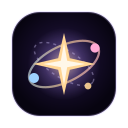
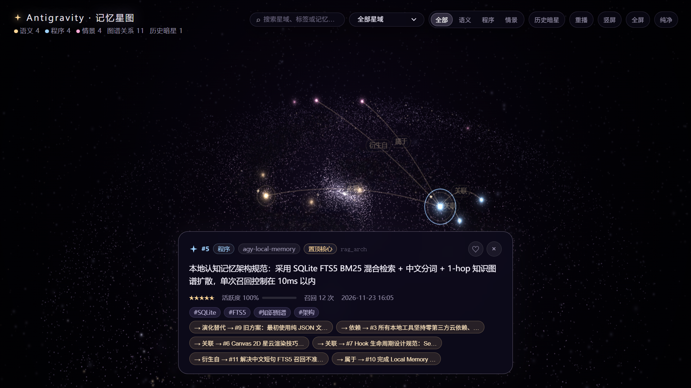
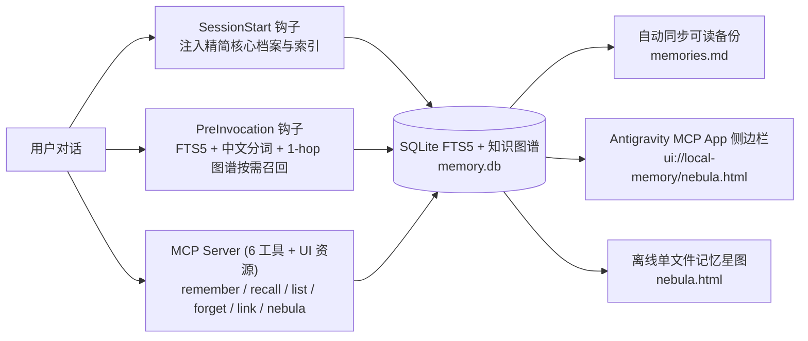

<p align="center">
  
</p>

<h1 align="center">Antigravity Local Memory · 记忆星图</h1>

<p align="center">
  <b>专为 Google Antigravity 打造的纯本地跨会话认知图谱记忆引擎 + 交互式银河星云可视化插件</b>
</p>

<p align="center">
  
  
  
  
</p>

<p align="center">
  
</p>

---

## ✨ 为什么做这个插件？

每次在 Antigravity 里新开对话，都要重新交代背景、项目规范和踩过的坑？第三方云端记忆服务又需要额外 API Key、收费或把个人数据传上云端？

**Antigravity Local Memory** 让你的 AI 拥有**100% 运行在本机**的长期记忆与可视化星云大脑：

* 🔒 **纯本地零依赖**：仅使用 Python 标准库 + 内置 SQLite FTS5，**无需 `pip install`、无需外部 API Key、零额外费用**，所有数据留在你自己的电脑里。
* 🧠 **三层认知结构（CoALA）**：
  * **暖金 · `semantic`（语义记忆）**：长期稳定的个人背景、专业领域与核心偏好。
  * **冰蓝 · `procedural`（程序记忆）**：可复用的工作流、格式规范、避坑指南与最佳实践。
  * **柔粉 · `episodic`（情景记忆）**：带时间线的阶段进展、实验结论与重要里程碑。
* 🗂️ **工作区隔离**：自动区分 `global` 全局档案与各项目工作区记忆，多个项目并行不串台。
* ⚡ **两级自动钩子，省 Token 又精准**：
  * `SessionStart`：仅注入极精简的置顶核心档案 + 分层索引，避免启动上下文膨胀。
  * `PreInvocation`：每轮按提问做毫秒级 **FTS5 BM25 + 中文分词 + 1-hop 知识图谱扩散** 按需召回（内置多步循环去重与防误触发过滤，Fail-Open 容错永不阻塞对话）。
* ⏳ **记忆演化与衰减**：非置顶记忆随时间幂律衰减、命中自动强化；方法变更支持 `supersedes` 保留演化脉络，也支持 `archive` 软归档。
* 🌌 **双模交互式记忆星图（v2.2 新增 MCP App）**：
  * **Antigravity 内置侧边栏 / 全局页（MCP App）**：对话里直接唤起，零跳转在应用内拖拽旋转、缩放、搜索、点击星辰点亮知识图谱星座。
  * **独立离线单文件（`nebula.html`）**：每次更新记忆自动同步，离线双击即可在浏览器漫游。

---

## 🏗️ 工作原理



---

## 🚀 一键安装

### 前置条件
* 已安装 **Google Antigravity**（桌面端或 IDE）
* 已安装 **Python 3.10+**（系统自带标准库 `sqlite3`，无需安装任何第三方包）

### 安装步骤

1. 获取安装包（任选一种方式）：
   * **方式 A（推荐，免装 Git）**：前往右侧 **[Releases 页面](https://github.com/pvijaypal2000-tech/agy-local-memory/releases/latest)** 下载 `agy-local-memory-v2.2.0.zip` 并解压到任意文件夹。
   * **方式 B（Git 克隆）**：
     ```bash
     git clone https://github.com/pvijaypal2000-tech/agy-local-memory.git
     cd agy-local-memory
     ```
2. 运行对应平台的一键安装脚本（脚本会自动复制插件、生成适配本机 Python 路径的配置，并运行全套自动化自检）：
   * **Windows**：直接双击 `install.bat`（或在终端运行 `.\install.bat`）
   * **macOS / Linux**：
     ```bash
     bash install.sh
     ```
3. **完全退出并重启一次 Antigravity**。
4. 新开对话，直接对它说：**「打开我的记忆星图」**，即可看到内置的 3 颗入门引导星辰与星座连线！

> 💡 体验完入门示例后，随时可以直接说：**「清空这 3 条入门示例记忆」**，即可开始沉淀你自己的专属星海。

---

## 💬 常用对话玩法

安装完成后无需背诵命令，用自然语言即可管理记忆：

* **写入语义/程序/情景记忆**
  > “记住：我平时主要用 Python 和 TypeScript，代码注释优先用中文（语义记忆，置顶）。”
  > “记住这条规范：导出的图表统一用 300 DPI + 无右上边框，并关联到当前项目（程序记忆）。”
* **演化更新（保留历史而非冲突）**
  > “记住我画图工具已从 Matplotlib 切换到 Plotly，替代之前的旧记录。”
* **检索与整理**
  > “回忆一下我之前记录过的项目规范和踩坑经验。”
  > “按认知分类列出我目前的全部本地记忆。”
* **归档或遗忘**
  > “把关于 XX 项目的旧记忆软归档 / 彻底忘掉。”
* **查看记忆星图**
  > “打开我的记忆星图”（在 Antigravity 内置侧边栏渲染）
  > “在浏览器里打开我的记忆星图”（调用系统浏览器打开独立 `nebula.html`）

---

## ⌨️ 星图交互说明

| 操作 | 效果 |
| :--- | :--- |
| 左键拖拽 | 旋转 / 平移星云视角 |
| 鼠标滚轮 | 平滑缩放星系 |
| 点击任意星辰 | 查看记忆详情并点亮其 **知识图谱星座连线** |
| 顶部筛选栏 | 按认知层级（暖金语义 / 冰蓝程序 / 柔粉情景）、工作区与关键词实时过滤 |
| 搜索结果点击 | 飞镜平滑聚焦到目标星辰 |

---

## 📂 仓库结构

```text
agy-local-memory/
├── install.bat                  # Windows 一键安装入口
├── install.sh                   # macOS / Linux 一键安装入口
├── install_helper.py            # 跨平台安装器 + 端到端自动化自检
├── LICENSE                      # MIT 协议与致谢
├── README.md
└── plugin/
    ├── plugin.json              # Antigravity 插件元信息
    ├── seed_memories.json       # 首次启动的 3 颗入门星辰与 2 条连线
    ├── assets/logo.svg          # 插件图标
    ├── rules/AGENTS.md          # 注入给 Agent 的记忆使用规范与隐私护栏
    ├── skills/memory-management/
    │   └── SKILL.md             # 记忆管理与星图查看技能说明
    ├── scripts/
    │   ├── memory_store.py      # SQLite FTS5 + 知识图谱 + 衰减强化核心引擎
    │   ├── mcp_server.py        # 纯标准库 Stdio MCP 服务（6 工具 + MCP App）
    │   ├── nebula_export.py     # 星图离线 HTML / MCP App 渲染器
    │   ├── session_start.py     # SessionStart 精简档案注入钩子
    │   └── pre_invocation.py    # PreInvocation 按需 JIT 召回钩子
    └── templates/
        ├── nebula_template.html # 纯 Canvas 2D 螺旋银河星云单文件模板
        └── mcp_app_bridge.min.js# Antigravity MCP App 通信桥接脚本
```

---

## 🛡️ 隐私与数据安全

* 所有记忆仅保存在本机的 Antigravity `PLUGIN_DATA` 目录（或插件 `data/` 目录）下的 `memory.db`、`memories.md` 与 `nebula.html` 中，不会向任何外部服务器上传。
* 内置 `AGENTS.md` 规则默认禁止将密码、API Key、身份证号、手机号等敏感隐私写入长期记忆。
* 你可以随时直接打开 `memories.md` 人工审阅，或直接删除数据库文件彻底清空。

---

## 🔗 姊妹插件推荐

搭配同系列悬浮桌宠插件一起使用，可在猫娘桌宠右键菜单或效率工具箱中**一键直达你的记忆星图**：
* 🐱 **[agy-gemini-pet](https://github.com/pvijaypal2000-tech/agy-gemini-pet)** — Gemini 蓝紫猫娘 · Antigravity 透明悬浮监测桌宠（5 套内置皮肤、0 Token 实时账单监测、6 音色音效台、番茄钟与星喵贪吃蛇）

---

## 🙏 致谢与开源协议

本项目采用 **[MIT License](LICENSE)** 开源。

* 纯 HTML5 Canvas 2D 螺旋银河星云可视化美学（多层螺旋粒子、暗尘带、点击点亮星座、离线单文件体验）灵感来源于 MIT 开源项目 **[「拾光 · 记忆星图」](https://github.com/Ningning600/shiguang)**。
* 内置的 Antigravity MCP App 通信桥接模块基于 MIT 开源的 `@modelcontextprotocol/ext-apps` 打包构建。
